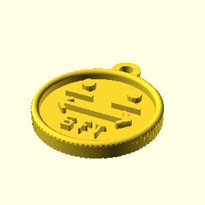
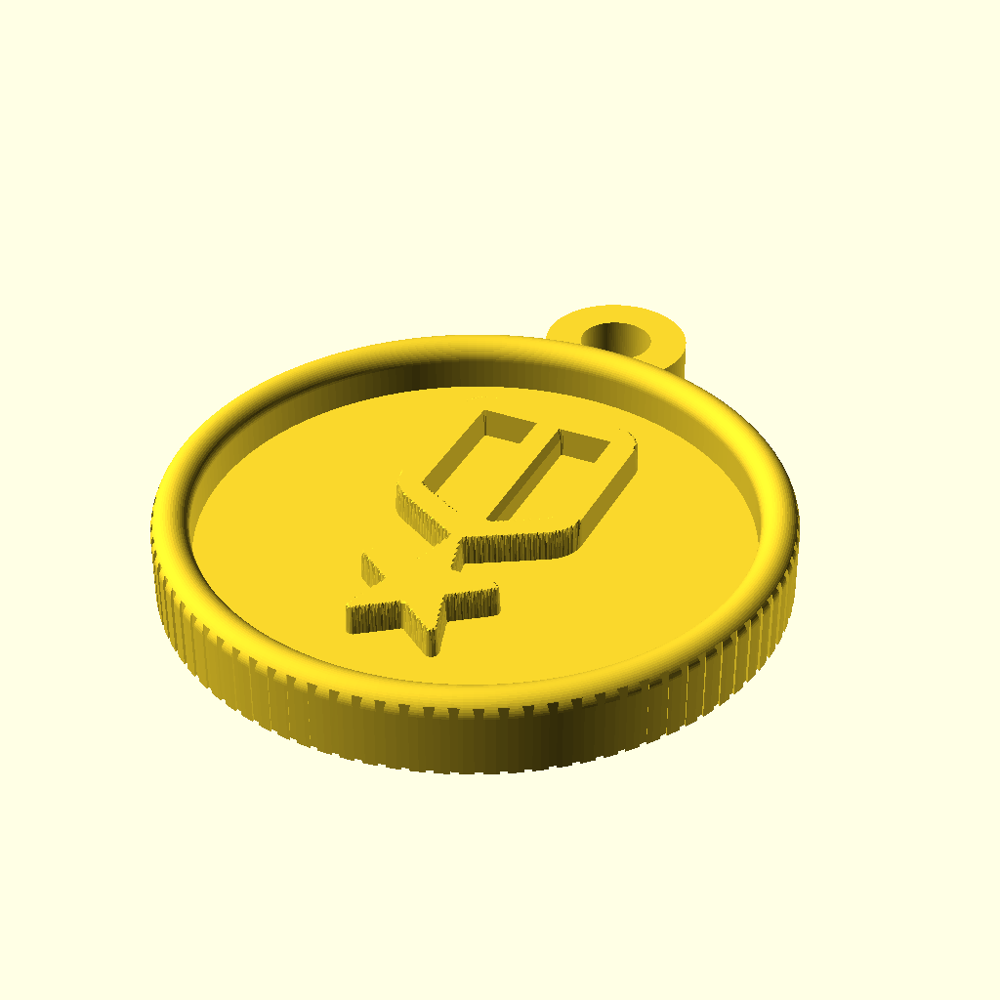

# 🪎 3D Printed Charms & Coins
"You've Got This."

## Backstory
We've all several missions in life... From collecting quotes, recipes, 'tech, we each might also enjoy [playing for keeps](https://www.youtube.com/watch?v=-nZWOszrP0o)?

So THIS sprint began with creating some coins for zChess .. then zCheckers.

How it works:

## REWARDS MEAN MOST WHEN EARNED
That lesson is simple - yet with our twist on a classic game everyone can yet indeed walk away with ... something.

So welcome to "zChess" mates! (pun intended.)

zVideo [is here](https://www.youtube.com/watch?v=-nZWOszrP0o).

---

### Game One: Playing for Keeps
When we decide to print our own unique colors then many might play for 'keepsakes.

Even if [checkers is your game](https://www.thingiverse.com/thing:7418438) then color every piece, print your loot, and also "play for keeps".

Designed to be smacked-upon a chess board (or a magnetic-backed 'fridge) the holes on these designs also permit many to be strung (like tiki beads from the 1960's) using [the happy jack](https://www.thingiverse.com/thing:7408351). (*)

### Game Two: Playing for Rank
So kings or knights, queen or rooks - what if you or I could display any bandoleer full of our wins? Color coded for any quantities captured?

So for seasoned gamesters, consider the bandoleer / sash of merit ?

| Coin| Value| Color| Honor|
| :--- | :--- | :--- | :--- |
| **1** | 1| **Gray** | Foundational, neutral starting baseline. |
| **2** | 5| **Brown** | A calm, low-intensity cool tone indicating early progress. |
| **3** | 10| **Bronze** | Showing established growth. |
| **4** | 50| **Yellow** | Transitions into stable, positive territory. |
| **5** | 100| **Blue** | Representing the halfway milestone. |
| **6** | 500| **Red** | Shifts into high-visibility, energetic warm tones. |
| **7** | 1000| **Orange** | Signals increasing intensity and advanced scaling. |
| **8** | 5000| **Green** | The standard color, representing peak intensity. |
| **9** | 10000| **Gold** | Classic, reflective premium status tier. |
| **10** | 50000| **Silver** |Brilliant, The highest multiple. |

Quantity -v- quality: Is any bronze king award better than the red pawn achievement?

### Game Three: "Celebrity Chess"
Fame, Fortune & Fun - You might even put your own QR code on the back: "Of course I lost to the grand master - but here is his rook."

~ or ~

What would YOU pay for a chance to own one of Trump's pawns? Elon? Gates? Oprah? --- The Sultan of Salami?

To lose a little could be to win ... a lot ... 'o loot?

A win - for everyone?

(And trust me - the game MUCH changes when everyone is not as interested in our king - but is instead fighting for ... your souvenirs!)

And yes, a red king award better than the orange pawn achievement ... 'cuz you're possibly pawn-silvered.

### HAPPY QUESTING!

Take my idea - please ... and you're welcome.

---

 
<a href="https://www.thingiverse.com/thing:7437263">2026_11_18: The Coin & Charm for "Social Distancing"</a>

---
  

<a href="https://www.thingiverse.com/thing:7438276/files">2026_11_21: Coin & Charm Award</a>

---
